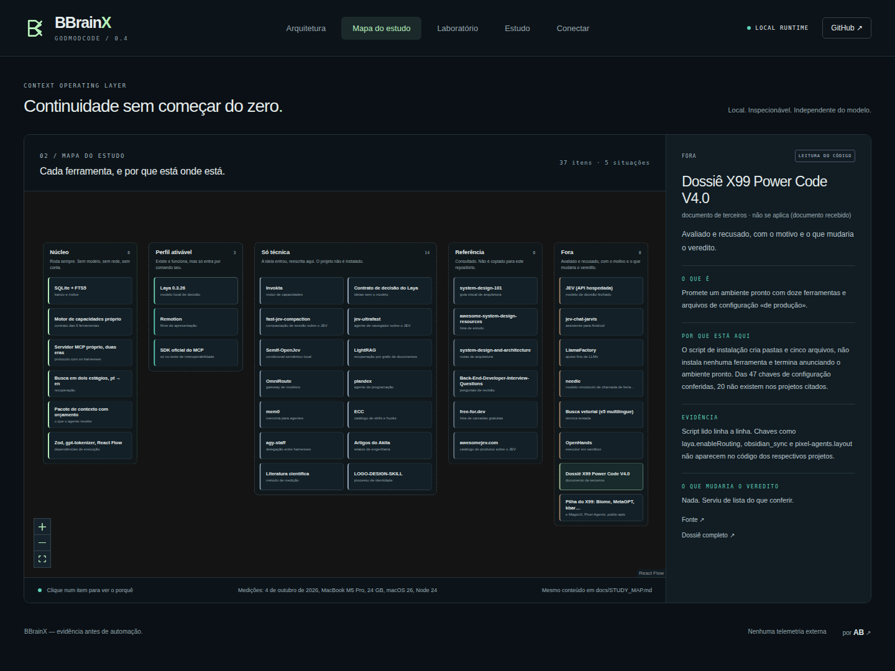
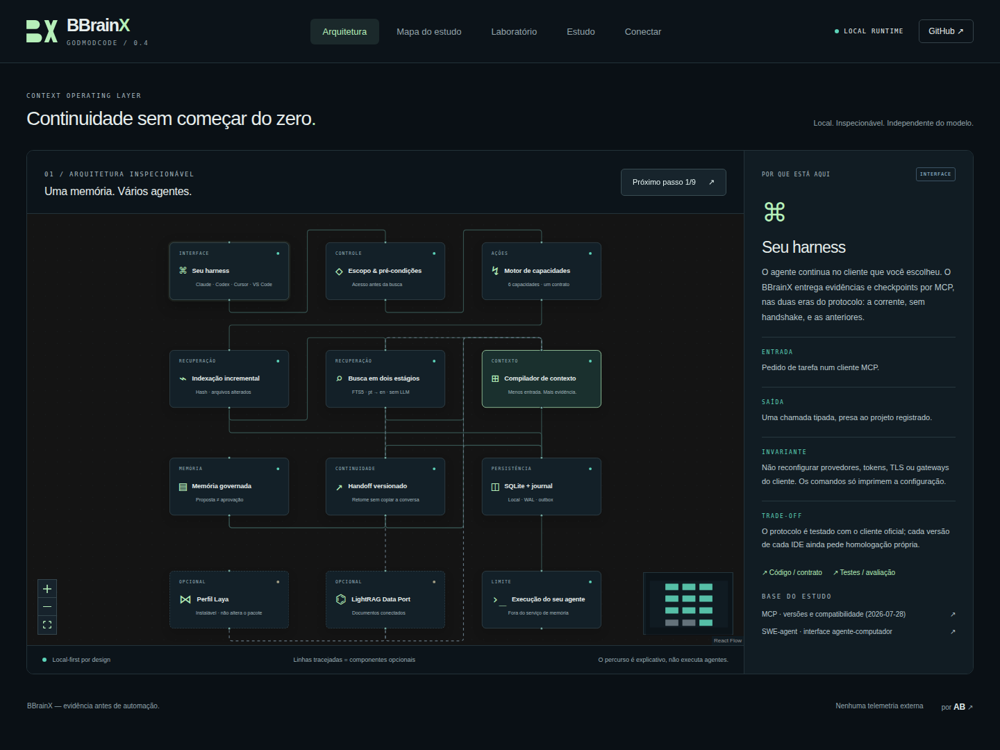

<p align="center"></p>

<p align="center"><strong>Continue the work. Do not rebuild the whole conversation.</strong><br/>Local context, governed memory and verifiable handoffs across coding agents.</p>

<p align="center"><a href="https://github.com/oalexandrebelo/BBrainX/actions/workflows/verify.yml"></a> · <a href="docs/QUICKSTART.md">Quickstart (pt-BR)</a> · <a href="docs/STUDY_MAP.md">Study map</a> · <a href="docs/DOSSIER.md">Research dossier</a> · <a href="docs/SECURITY_MODEL.md">Security</a> · <a href="docs/EVALUATION.md">Evaluation</a> · <a href="README.md">Português</a></p>

## BBrainX 2.1 · Claude and Codex working together

Version 2.1 retains the 2.0 AB-BBX foundation and targets general project work, prioritizing Mac mini and MacBook Pro M5. Public search/context verify worktree hashes and refuse stale indices with `INDEX_STALE`; run `context_index` and retry. `index-status --project ID` provides a read-only diagnosis. The local panel reports search/context/checkpoint counts per session without storing queries. [Release contract and repository review](docs/BBRAINX_2_0.md).

BBrainX was built to accelerate real project work and shared to make verified continuity portable across coding agents. AB-BBX is its own capability execution core (`src/ab-bbx.mjs`), with a compatible legacy entrypoint. Run `node bin/bbrainx.mjs watch --project ID` in a separate process to periodically reconcile an index; add `--lane ID` for a registered workspace lane. This does not install a service or alter harness configuration. [Operating contract and limitations](docs/AB_BBX.md).

### Recruit agents (BYO: your CLIs, your logins)

In Claude, ask **"use BBrainX to recruit 1 codex luna 6 high in review mode to answer OK; wait and bring the result here"**. In Codex, ask **"use BBrainX to recruit 1 claude opus 5.5 xhigh to review X; wait and bring the result here"**. The parent harness calls `agents_recruit`, polls `agents_status`, and presents the result in the chat. Normal Claude desktop chats can also recruit through their enabled local connector.

BBrainX runs the CLIs already installed and logged in on this machine, each recruit in its own worktree, branch and lane. Authentication remains with Claude Code or Codex: BBrainX does not read tokens, change logins or migrate accounts. Available models and reasoning efforts depend on the selected CLI and account; use explicit versions for reproducible requests. `integrate --apply` includes `--recruit` by default; `--no-recruit` keeps the six context tools. The `config` generators require explicit `--recruit` to expose all nine tools.

Version 2.1 preserves major-only Claude IDs, restricts model selection per Claude process, and skips automatically discovered executables that fail `--version`, including broken PATH wrappers. It supports explicit binary selection and generates a Claude desktop fragment. [Connections, accounts and optional OmniRoute](docs/integrations/HARNESS_CONNECTIONS.md) · [Recruitment and limits](docs/RECRUIT.md) (pt-BR).

## What it is

BBrainX runs on your machine and gives a coding agent what it needs to continue a task: the right excerpts of the repository, the checkpoint of the previous session and the memories you approved. It speaks MCP. The core uses no model, account, Docker or Python and makes no outbound network calls.

| Client | Connection |
|---|---|
| Claude Code, including VS Code | `integrate --clients claude --apply`; approve the project MCP in the client |
| Codex app, CLI and extension | `integrate --clients codex --apply`; the client must trust the project and load its local configuration |
| VS Code MCP | `integrate --clients vscode --apply`; start the server in the editor |
| Claude desktop, normal chat | `config --client claude-desktop --project ID --recruit`; merge the local block with a backup and restart the app |
| Cursor, Gemini CLI, Kilo, Antigravity | Existing generators; configuration alone does not certify a native connection |

This branch prepares **2.1.0 Developer Preview**, based on revision `689a5a6` from 2.0. Being in Git does not establish a merge into `main`, installation on other machines or certification of every client. Windows remains a backlog target. [Changes and evidence by version](docs/RELEASE_NOTES.md).

## Start in three commands

Requirements: **Node 24 LTS and Git** (Node 22.20 or newer also works). This phase focuses on macOS (arm64). macOS and Linux are required CI targets. Windows results remain visible but do not block the Mac release. Verify the PR head rather than treating historical reports as current certification.

```sh
git clone https://github.com/oalexandrebelo/BBrainX.git && cd BBrainX
npm run setup
node bin/bbrainx.mjs up --root /path/to/your/project
```

- `npm run setup` checks the host, installs exactly the lockfile (no lifecycle scripts), runs the tests and builds the panel.
- `up` registers the folder, indexes it and prints the next step for each harness. Running it again only updates what changed.
- `node bin/bbrainx.mjs doctor` reports the best scenario for this machine and the command for each step. It only observes: it installs nothing and never runs the tools it finds.

To wire it to your harness:

```sh
node bin/bbrainx.mjs integrate --root /path/to/your/project
node bin/bbrainx.mjs integrate --root /path/to/your/project --apply
```

Without `--apply`, `integrate` reports paths, hashes and pending steps. With `--apply`, it registers the root, writes the project's MCP entry with private backups and indexes the files; it preserves credentials, providers, trust and approvals. It discovers Codex, Claude Code, VS Code, Kilo and Antigravity IDE from local metadata, without running clients. Codex, Claude Code, VS Code and Kilo have automatic configuration; Antigravity IDE needs a manual step and gets no global registration of all projects. `--clients codex,claude,vscode,kilo` selects the targets, including a client that is not installed yet. Older installations can be migrated with `--adopt-existing` only when they exactly match the previous generator. Rollback: `node bin/bbrainx.mjs integrations rollback --id RECEIPT_ID`; a later edit prevents the overwrite. [Installer contract](docs/integrations/INSTALLER.md) (pt-BR).

`config --project my-project --client cursor` still prints fragments for manual integration (it also accepts claude, claude-desktop, codex, vscode and gemini; add `--recruit` to enable recruitment). Configuration being present is not evidence of a native connection. `npm start` runs `node bin/bbrainx.mjs serve`: it serves the panel at **http://127.0.0.1:4317** (port: `serve --port N`) and **does not open the browser**. It needs the build made by `npm run setup`. On macOS, `Start-BBrainX.command` (double click) runs `npm run setup` and `npm run demo`, serves the panel and opens the browser.

The [own BBrainX extension](extensions/vscode/README.md) offers the brand, a tree of open folders and Detect/Connect commands in VS Code, and a VSIX for evaluation in Antigravity IDE. Package it with `node scripts/package-extension.mjs` (Python 3 for packaging only), install the VSIX from the editor and set the executable in user settings. Trusted folders emit metadata heartbeats every 30 s; they expire after 90 s and do not register or index projects on their own. `node bin/bbrainx.mjs discover --root /path/to/project` separates reported open folders, registered projects and historical sessions with a validated root; it does not capture every active session of every IDE.

```sh
node bin/bbrainx.mjs test --project my-project --file test/auth.test.mjs --timeout 300000
node bin/bbrainx.mjs control --project my-project
node bin/bbrainx.mjs import-context --project my-project --harness claude --file /absolute/path/session.jsonl
```

`test` runs concrete `node:test` files under the registered root, with bounded progress and diagnostics; it runs with local user permissions and is not a sandbox. `import-context` requires an explicit choice of a native Claude, Codex or Cursor file and creates a `review_needed` checkpoint with untrusted excerpts; it grants no access and approves no memory. Private sources stay in local state. Other history formats are refused. Cursor without a cwd requires `--confirm-workspace /canonical/root`, stays marked as source-unverified and rejects ambiguous names. [Steps and limits](docs/QUICKSTART.md#4-conectar-harnesses) (pt-BR).

If you prefer the agent to do the wiring, paste the prompt in [docs/prompts/ACTIVATE.md](docs/prompts/ACTIVATE.md) into its session. Anyone taking over the project starts at [docs/HANDOFF.md](docs/HANDOFF.md). Both are in Brazilian Portuguese.

## What was measured

| Measure | 0.3 | 0.4 | 1.5.0 | How |
|---|---|---|---|---|
| Expected file among the first 10, natural-language question | 54% | **84%** | not repeated | 79 blind questions written by another author who never saw the search engine, over two third-party repositories |
| Expected file in first place, same questions | 33% | **46%** | not repeated | The 95% intervals overlap (24–44% and 35–57%); case by case, the rank improved in 40 and got worse in 7 |
| Definition of an identifier in first place | 12 of 12 | 12 of 12 | 12 of 12 | Labeled cases over this repository (`test/fixtures/eval-self.cases`), used as a regression gate |
| Production packages in the lockfile | 121 | **25** | 27 | 121 → 25: [docs/RELEASE_NOTES.md](docs/RELEASE_NOTES.md). 27: `package-lock.json` of this revision (7 direct dependencies) |

Blind questions: measured on the 0.4 search (revision 4785d4d, 4 October 2026). Not repeated on 1.5.0. These numbers measure the rank of the expected file, not accepted tasks or billed token savings. Method, intervals and reproduction commands are in [docs/EVALUATION.md](docs/EVALUATION.md) (pt-BR).

### Token cost in 1.5.0

| Measure | Before | After |
|---|---|---|
| `context_search`, mean per answer, 36 queries, default budget of 4,000 tokens | 17,397 | **3,517** (−79.8%) |
| Expected file located | 31/36 | 31/36 |
| Expected file with its body in the result | 31/36 | 23/36 |
| `tools/list` on the wire | 2,431 | 1,925 (−20.8%) |
| Instructions + tool definitions, per turn | 1,498 | 1,396 (−6.8%) |
| `context_bootstrap`, 5 tasks | 4,818 | 4,126 (−14.4%) |

Retrieval floor (`test/godmode.test.mjs`, 36 queries over this repository, one hit per file): expected file among the first 10 in **0.889** (32/36); the test requires 0.85.

Source: [docs/engineering/PERFORMANCE.md](docs/engineering/PERFORMANCE.md) (pt-BR), base `5acad77`. Repeated on revision 77e6ddd (1.5.0) with `node scripts/measure-search-tokens.mjs`: 17,778 → 3,666 (−79.4%), located 31/36 → 31/36, with body 31/36 → 20/36. The value changes with the indexed corpus. Tokens are `o200k_base` over the payload, not provider billing. The response carries the same JSON in `content` and in `structuredContent`; that duplication is not addressed (task T1: 10,125 tokens on the wire against 4,978 of text).

## Six tools, one scope (nine with `--recruit`)

| MCP | Responsibility |
|---|---|
| `context_bootstrap` | Build a pack with a token budget, with path, lines and hash of each excerpt. |
| `context_search` | Search the index; the declaration of a name comes before its usages and tests. One hit per file and at most `budget` tokens (default 4000); what does not fit comes back as `path:lines`. |
| `context_index` | Refresh the index of the registered folder. |
| `session_checkpoint` | Save the task state: what was done, decisions, touched files, evidence. |
| `session_get` | Retrieve the checkpoint, in another harness or another session. |
| `memory_propose` | Propose a learning. Only you approve it, from the terminal. |

The server is original code and speaks **both eras of MCP** in the same process: the current revision (2026-07-28, no handshake) and the earlier ones (with `initialize`). The official protocol client talks to it in the tests. That validates the protocol; it is **not a certification of every version of every IDE**.

The server only sees the project it was started with and approves no memory. The six basic tools do not execute project commands; the three opt-in recruitment tools launch authorized CLIs in their own lanes. Retrieved text is evidence, never instructions.

## SDD alignment per project

BBrainX detects Spec Kit and recognized SDD documents, gives a versioned **documentary coverage** score per feature and points out requirements without tasks or orphan references. When there is no SDD, the explicit alignment action creates `SDD.md` as a technical draft with sources; it preserves any existing or partial structure.

```sh
node bin/bbrainx.mjs sdd --project my-project
node bin/bbrainx.mjs sdd --project my-project --mode assess
node bin/bbrainx.mjs mcp --project my-project --sdd
```

The **SDD** tab offers assessment and alignment in the panel. The first command creates only when absent; `assess` is read-only. MCP exposes `sdd_align` as an opt-in. The score does not certify semantics, implementation or tests: [contract and rubric](docs/integrations/SDD.md) (pt-BR).

## Optional profile: Laya

[Laya](https://github.com/NandhaKishorM/laya) is a local decision model: it picks among options, scores or answers yes/no, and generates no text. BBrainX installs it **only on your command**, in an isolated Python environment, with weights verified by SHA-256:

```sh
node bin/bbrainx.mjs laya install     # about 0.7 GB of environment and 0.68 GB of weights
node bin/bbrainx.mjs laya ask --state "Login broke in production." --file questions.json
node bin/bbrainx.mjs laya remove
```

The profile also offers local decisions in the panel (`serve --laya`), in the CLI (`laya decide --project ...`) and in MCP (`mcp --project ... --laya`, tool `decision_evaluate`). It includes an exact cache per project/process, cancellation, resource limits and abstention when text, question or options are truncated. The returned confidence is not calibrated. [Activation, contract and evidence](docs/integrations/LAYA.md) (pt-BR).

Network: the code only sets the libraries' offline-mode flags in the model process (`HF_HUB_OFFLINE=1`, `TRANSFORMERS_OFFLINE=1`, `HF_HUB_DISABLE_TELEMETRY=1`; `src/worker-env.mjs` and `profiles/laya/worker.py`). **There is no operating-system-level network block.** The process environment does not inherit API keys, `PYTHONPATH` or `NODE_OPTIONS`. Installation downloads dependencies and weights.

Measured on an Apple M5 Pro, 24 GB, GPU (MPS), on 4 October 2026: 4 to 18 s to load, about 8 ms per short decision, 1.8 GB peak RAM ([docs/OPTIONAL_PROFILES.md](docs/OPTIONAL_PROFILES.md), pt-BR). The historical search and memory-relevance trials showed no benefit over the lexical baseline: without fine-tuning, first place dropped from 42% to 6% when reordering ([docs/EVALUATION.md](docs/EVALUATION.md), pt-BR). The model **does not change the context pack**. The integration shows local execution and an environment without keys; it does not show superiority over JEV, API savings or universal quality.

## Study map

Thirty-seven tools were studied. Each sits in one of five situations — **core**, **activatable profile**, **technique only**, **reference** or **out** — with the reason, the evidence and what would change the verdict. The map is interactive in the panel (**Study map** tab) and written out in [docs/STUDY_MAP.md](docs/STUDY_MAP.md) (pt-BR).



## Decisions that avoid waste

**Lexical before generative.** The index is SQLite FTS5; there is no LLM in indexing. Search runs in two stages: exact terms, then stems and a Portuguese → English programming glossary. **Context is selection, not a dump.** Each excerpt has a hash and a location; a changed file is re-read before being served; a mandatory constraint is not cut to fit. **Memory is not automatic truth.** The agent proposes, you approve. **Continuity is not an endless transcript.** The checkpoint carries what was done, what is left and which revision supports the state.

`payloadTokens` uses **o200k_base** over the pack only. The client's total tokens, another model's tokenizer, provider cache and financial savings are not inferred: they appear as unknown, not as zero.

## Quality and limits

```sh
npm test            # domain, protocol with real processes, profiles, study map
npm run build
npm run test:e2e    # panel in the browser
```

Validation for 2.1 must match the delivered revision; see the [release notes](docs/RELEASE_NOTES.md). Historical evidence for 1.5.0: 735/735 tests on Node 24.21.0 and Node 22.22.2 (macOS arm64); Playwright 24/24 (panel), 6/6 (usage) and 3/3 (control); MCP negative controls 7/7 detected (`node scripts/mcp-negative.mjs`). The CI workflow (`.github/workflows/verify.yml`) defines macOS, Linux and Windows, but **1.5.0 has no published CI report**: the one in `docs/validation/ci-report.json` is from revision 912aa25. The negative controls inject defects into an isolated checkout and require that they are detected. That does not imply mutation coverage of all tests. Next steps: [docs/HOMOLOGACAO_2026-10-10.md](docs/HOMOLOGACAO_2026-10-10.md#oportunidades) (pt-BR).

What does not exist: a continuous file watcher, language-server semantic analysis, multi-host sync, own encryption, multi-tenant authentication, screen capture and shell execution. A call deadline does not interrupt synchronous work such as indexing. Do not place the live database on iCloud or a network disk. Revoking a memory prevents future use, but does not erase historical copies or backups. See the [security model](docs/SECURITY_MODEL.md) (pt-BR).

## Brand

The official mark is the **BBX monogram** with the wordmark at the top of this page: panel icon, MCP handshake icon (Claude Code, Codex, VS Code) and VS Code extension icon. Palette, surfaces and how to regenerate them are in [docs/BRAND.md](docs/BRAND.md).

<p align="center"></p>

## Community

Project by Alexandre Belo (**AB**), built with AI assistance and evidence-driven review. No endorsement by OpenAI, Anthropic, Google or the studied projects is implied. We want reproducible contributions: [CONTRIBUTING.md](CONTRIBUTING.md).

To take the next contribution, start with the [engineering context](docs/engineering/CONTINUITY.md), run `npm run project:status` and pick an item from the [queue with acceptance criteria](docs/engineering/ROADMAP.md). The [experiment ledger](docs/engineering/PERFORMANCE.md) separates measured gains, costs and discarded attempts.

Original BBrainX code is MIT. AB-BBX is the project-owned capability engine. Historical attributions and full notices are in [THIRD_PARTY_NOTICES.md](THIRD_PARTY_NOTICES.md). The Laya profile and Remotion keep their own terms and are not part of the core. Names, marks, libraries and references keep their rights.

<!-- verified-preview -->
## Interface



[Last published CI report (912aa25)](docs/validation/ci-report.json) · [Explainer video](public/demo/bbrainx-intro.mp4)
