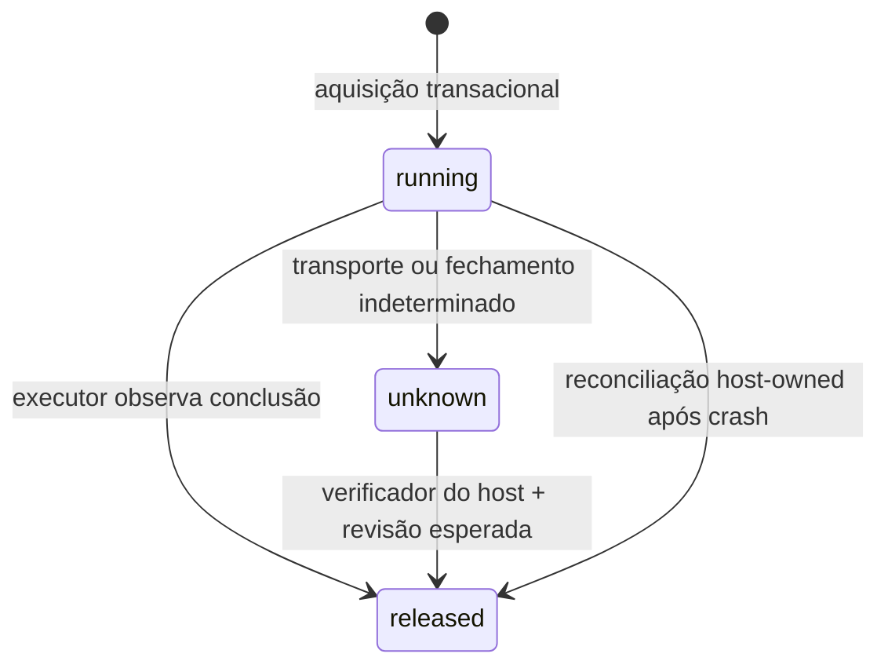

# State Commit 03A — admissão compartilhada e reconciliação observável

**Data:** 09/10/2026. **Base:** `b8d2c4730b797828244e914675890990eb1f2558`, tree `e483c824bd2fc2f980b9a9a1a5a3137c5d1bed63`. **Escopo:** primeira implementação da Bateria 3, não encerramento das cinco baterias. **Resultado remoto:** consultar o relatório de entrega; commit local não equivale a push.

## 1. Problema fechado nesta entrega

`ResourceAdmission` continua preservado com seu contrato por coordenador. Duas instâncias que individualmente admitem um modelo podem admitir dois no total; o teste de contraprova demonstra precisamente essa composição, sem atribuir ao mecanismo antigo uma garantia que ele nunca ofereceu.

`SharedAdmission` acrescenta uma autoridade persistente para os participantes cooperantes no mesmo `BBRAINX_HOME`. Um recurso possui identidade física declarada pelo host, máximo de slots e orçamento de bytes. Solicitações de processos distintos passam pelo mesmo arquivo SQLite. Alterar o nome lógico não pode registrar novamente a mesma chave física com outro orçamento. Isso não detecta aliases arbitrários de GPU inventados pelo operador: a configuração confiável continua responsável pela identidade real.

O núcleo lexical, o store de memória, os checkpoints, o esquema das lanes e as seis ferramentas MCP não foram substituídos. O novo perfil é opt-in. Clientes antigos que não utilizam essa autoridade continuam fora de seu controle. Não declarar cota global da estação inteira, proteção de sistema operacional ou compatibilidade de todas as IDEs por causa desses testes.

## 2. Implementação e API

- `src/shared-admission.mjs`: esquema independente, políticas, reservas, transições, reconciliação e inspeção paginada.
- `src/shared-admission.d.mts`: contrato TypeScript do consumidor; validações de runtime continuam obrigatórias.
- `src/shared-laya-broker.mjs`: ponte para o `LayaBroker` real, sem mudar pesos, parser ou regras de decisão.
- `scripts/admission.mjs`: registro, status e confirmação explícita de reconciliação pelo operador.
- `scripts/laya-shared.mjs`: execução opcional de um perfil Laya já instalado com escopo de projeto/lane conferido pelo host.

Biblioteca e CLI não expõem uma capacidade MCP de aprovação/reconciliação. O modelo não pode conceder um slot, afirmar que o processo terminou ou alterar limites pelo argumento de uma ferramenta.

## 3. Estado persistido e fronteira transacional

O arquivo é `BBRAINX_HOME/admission/admission-v1.sqlite`. A subpasta é privada (0700 em Unix) e arquivos 0600; o código recusa links simbólicos e hard links no arquivo. Windows usa as permissões herdadas do diretório do usuário; não se afirma que modos Unix imponham ACL no Windows. Diretório local confiável é uma premissa: não usar compartilhamento de rede, iCloud ou sincronização de um WAL vivo.

Tabelas: `admission_control`, `admission_resources`, `admission_reservations` e `admission_events`. O contador monotônico de gerações e os contadores de slots/bytes são atualizados na mesma transação `BEGIN IMMEDIATE` que insere a reserva e seu evento. A liberação modifica estado, contadores e evento na mesma transação. Falha de gravação do evento reverte tudo; testes injetam essa falha em SQLite real.

Só há transações curtas síncronas. Não se segura o writer esperando modelo, rede, usuário ou callback de reconciliação. SQLite permite leitores concorrentes, mas tem um writer por banco; `BEGIN IMMEDIATE` pode recusar por contenção. O timeout de busy é configurável, limitado e não equivale a um deadline hard real-time do processo. [S4][S5]

Na conexão, versão e `application_id` são validados. O hash da definição efetiva de tabelas/índices é comparado a uma instância de referência, e totais ativos são conferidos. Um banco desconhecido não é automaticamente convertido. Ausência de um índice, schema futuro, arquivo de outro domínio e divergência dos contadores causam recusa em vez de reinicialização.

O modo de observação não cria um banco ausente nem modifica dados de negócio. Como em qualquer leitura WAL, operações internas do SQLite não devem ser confundidas com filesystem completamente imóvel.

## 4. Máquina de estados e prova de conclusão

`running` e `unknown` conservam slots e bytes. Não há lease que libera por TTL. Fechar o objeto ou morrer não equivale a encerrar trabalho externo. Um token gerado por `randomBytes(32)` identifica o dono da reserva; apenas seu hash fica no banco. Geração, recurso e UUID do ledger também precisam corresponder. A cópia pública não contém token ou token hash.

Callbacks antigos não liberam reservas novas. Repetir a mesma conclusão com revisão e evidência idênticas é idempotente; tentar alterar a evidência ou utilizar outra revisão causa conflito. A API ordinária de `release` não pode liberar uma reserva `unknown`.

Reconciliação recebe um verificador síncrono instalado pelo host. Ele é executado fora do writer, com uma cópia da reserva e do descritor de prova. A transação final confere novamente a revisão. Se outro processo marcar a reserva como incerta no intervalo, a liberação falha. Retornar um objeto truthy ou uma Promise não é aprovação.

O hash da evidência é uma referência, não uma assinatura, prova de acurácia ou autenticação de produtor. O verificador precisa conhecer a fronteira observada. O CLI administrativo exige `--confirm-resource-stopped` e registra explicitamente **declaração do operador**, não detecção automática de término. Não sinaliza processos nem usa PID/porta como evidência.

## 5. Integração Laya: contabilizar residência, não apenas uma chamada

`SharedLayaBroker` usa o broker existente e reserva antes de permitir criação do worker. A vaga permanece enquanto seus pesos podem continuar residentes, mesmo depois da resposta. Isso evita a falsa economia de liberar um slot após cada request e deixar vários modelos carregados.

A política inicial é simples e explícita: outra sessão encontra backpressure enquanto a primeira mantém o worker residente. O primeiro chamador pode reutilizar o worker entre decisões e deve chamar `stop/close` para entregar capacidade. Esta versão **não é um daemon compartilhando uma única instância neural entre todas as IDEs**, nem oferece fila justa entre consumidores. Justiça, multiplexação de assinantes e batching são etapas futuras, não capacidades sugeridas pela presença do ledger.

A ponte libera somente depois de `processClosedObserved`. Um teste real faz o pai sair enquanto um filho de vida curta conserva stdout aberto. A primeira parada não declara limpeza, mantém `unknown` e impede o segundo broker de carregar. Quando o pipe finalmente fecha, uma reconciliação apoiada na observação do próprio broker libera a reserva. O teste não prova contenção de descendentes hostis; o canal permanece cooperativo.

Também foram corrigidas duas condições na própria implementação candidata: capturar states/questions/options antes do primeiro microtask e bloquear novas decisões assim que `close` é solicitado. Sem isso, mutação da entrada ou uma decisão nova durante o fechamento poderia romper a associação entre pedido e reserva. Os casos específicos permaneceram na suíte.

O caminho de rede System One descrito no State 02 ainda precisa de integração independente. Um cliente HTTP ter fechado não comprova que um servidor remoto terminou a inferência. Portanto, esta ponte local não deve ser reaproveitada para liberar pedidos Jev/OpenJev remotos por analogia.

## 6. Memória, segurança e limites de retenção

Os bytes da reserva são uma declaração de custo fornecida pelo host, não medição de RSS, ativações ou VRAM. `hardRssLimit` permanece false. O `ResourceAdmission` com pressão térmica/amostras não foi integrado silenciosamente: a coordenação de reservas resolve outro problema. Para proteção física da estação ainda são necessários dimensionamento, amostragem e um executor que respeite os limites.

Até 128 recursos e 64 slots por recurso. O orçamento individual máximo é 8 TiB para manter operações inteiras seguras; esse teto de validação não é recomendação de hardware. O histórico default admite 100.000 aquisições; o teto configurável é 1.000.000. Atingir o histórico produz `ADMISSION_HISTORY_LIMIT`, não descarte silencioso de reservas/evidências. A política é deliberadamente conservadora. Retenção compactável com watermark e exportação verificável permanece pendente antes de uso de alto volume por períodos extensos.

Não há migração em `brain.sqlite`. Reversão do código deixa o ledger preservado. **Não excluir/restaurar o ledger enquanto qualquer participante ou worker puder estar ativo**: recriá-lo com contadores vazios poderia readmitir trabalho sobre recurso ocupado. O UUID distingue handles, mas não é um mecanismo mágico para recuperar direitos de uma autoridade apagada. Reinstalação segura exige quiescência e preservação do estado antigo.

A proteção assumida é cooperação entre processos do mesmo usuário. Um processo malicioso desse usuário pode modificar arquivos ou chamar o servidor diretamente. Métodos locais e hashes não estabelecem uma sandbox contra ele. As receitas não mudam confiança da IDE, credenciais, gateways ou permissões globais.

## 7. Verificação empírica

A base de 342 testes foi reexecutada antes da implementação. A primeira versão completa acrescentou 51 casos de runtime, levando a 393 testes aprovados. O relatório da entrega é autoritativo caso haja novos casos após esta redação. A contagem não soma cada repetição como teste diferente.

Os ensaios incluem:

- Dois processos disputando um slot; oito disputando dois; oito produtores com 800 tentativas sob contenção.
- Dois processos reais contendo brokers, com apenas um worker admitido; o recusado não inicia subprocesso.
- SIGKILL antes de COMMIT em uma transação SQLite real e depois da aquisição pela API. O ensaio anterior ao COMMIT prova rollback do armazenamento, não todas as instruções possíveis do módulo.
- 1.200 transições geradas deterministicamente confrontadas com um modelo de referência independente de reservas.
- Token/recurso/ledger divergentes, callbacks antigos, reconciliação concorrente e retorno assíncrono indevido do verificador.
- Falhas de auditoria, schema futuro, índice removido, budget divergente, histórico esgotado, hard link, paginação e status ausente.
- UTF-8/entradas e lifecycle nos testes gerais já existentes; esta entrega não os contabiliza novamente como novos.

Seis mutantes em cópias temporárias removeram limites, autenticação por token, proteção do close, evento de aquisição ou bloqueio de release incerto. Todos precisaram causar falha por assertion, não apenas syntax/import error. Esse resultado é um controle negativo de seis regressões escolhidas, não um mutation score abrangente.

Não foram executados pesos Fastino/Laya/Jev, faturas, IDEs autenticadas ou benchmark MEDIUM foreground. A nova árvore foi testada localmente em Linux/Node 24.21.0; aprovação da CI antiga não vale como CI desta alteração. Testes de falha usam produtores de protocolo identificados, não modelos falsos usados para atribuir acurácia ou ganho de inferência.

## 8. Desempenho medido e atribuição correta

`benchmark-shared-admission.mjs` registra 1.000 aquisições e 1.000 liberações após warmup, conservando amostras individuais e ambiente. Produz 10.000 reservas encerradas e uma ativa para comparar, em sete pares de ordem alternada, uma consulta de totais ativos com full scan versus índice parcial. Ambos retornam o mesmo resultado, e os planos SQL são publicados.

Essa comparação demonstra o retorno do índice neste conjunto construído. **Não é comparação da nova release inteira com a antiga, nem speedup de modelo, IDE, agente ou tarefa.** A documentação The Tail at Scale motiva avaliar a cauda e a composição, não transferir um multiplicador local a toda a operação. [S6]

A consulta de validação utiliza um índice apenas das reservas ativas/incertas; isso evita que o custo da inspeção cresça diretamente com todo o histórico encerrado. Statements são preparados uma vez por conexão. Aquisição/liberação têm um número limitado de operações SQL por transação. O custo físico de fsync, lock, page cache e scheduler não desaparece pela complexidade do algoritmo.

Quantis empíricos não são percentis garantidos de produção. O filesystem temporário do container não foi caracterizado como SSD nativo. Crescimento de WAL, longos leitores e competição com IDE/builds precisam ser medidos no ensaio MEDIUM, separadamente. [S5]

## 9. Estado de continuidade

Entregue: admissão multiprocesso persistente, reconciliação delimitada, ponte de residência Laya, CLI administrativo e de execução, declarações de tipos, testes, contraprovas e benchmark reproduzível.

Ainda aberto na Bateria 3: coordenação de serviços órfãos das lanes, limite de respostas/backpressure MCP, indexação cancelável e promoção de geração. Ainda aberto na Bateria 4: tarefas reais, foreground MEDIUM em Mac e comparação de custo/qualidade. Ainda aberto na Bateria 5: release da revisão final e validação externa. Nenhuma destas pendências foi convertida em 100% do produto.

Referências: `admission/FASTINO_E_FONTES.md` e relatório de evidências que acompanha o código. Documentos históricos permanecem como história, não são sobrescritos para alegar novas medições.
